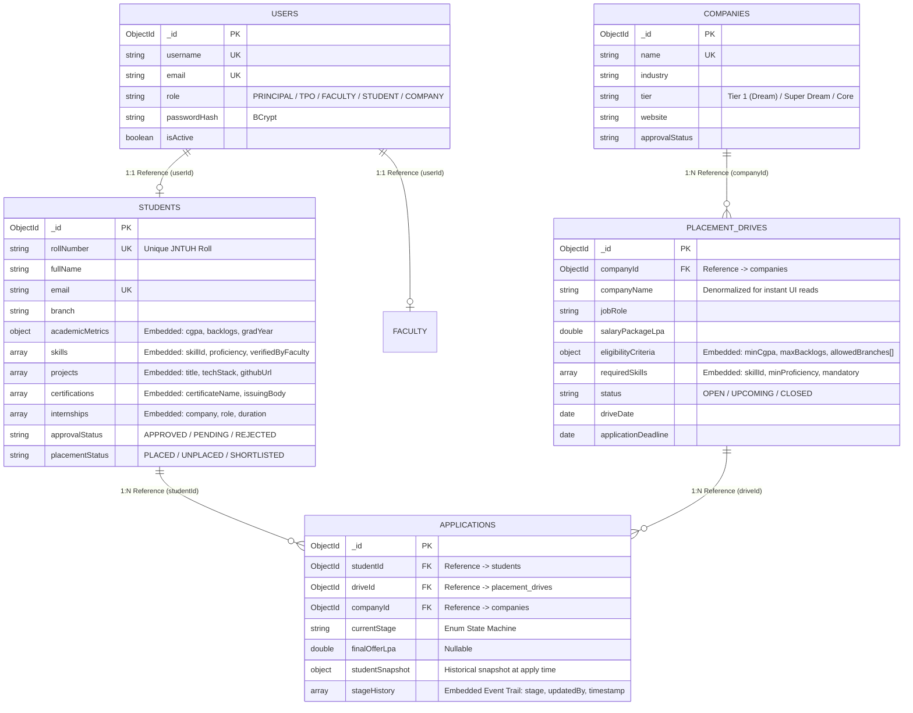

# GCET PLACEMENT HUB — MongoDB Document Database Architecture & Design Report

**Course Evaluation:** Database Management Systems (DBMS)  
**Institution:** Geethanjali College of Engineering and Technology (UGC Autonomous, Hyderabad)  
**System:** GCET Placement Hub (Java 17 Swing Desktop + MongoDB Atlas)  
**Authors:** M.J. Emmanuel & Development Team  

---

## 1. Executive Summary & Architectural Motivation

The legacy **GCET Placement Hub** utilized a normalized relational schema (MySQL 8) spanning 17 tables decomposed into Third Normal Form (3NF). While relational normalization eliminates update anomalies, modern campus placement systems exhibit distinct operational patterns:
1. **High Read-to-Write Ratio on Aggregated Student Profiles:** When recruiters or placement coordinators view a student, they require the student's core demographic record, academic metrics, verified skills, projects, certifications, and internship records simultaneously. In relational SQL, this required expensive 6-table `LEFT JOIN` operations across `students`, `student_skills`, `skills`, `student_projects`, `student_certifications`, and `student_internships`.
2. **Dynamic & Polymorphic Eligibility Rules:** Placement drives have rapidly changing criteria (varying allowed branches, backlogs, graduation years, and specific proficiency gates across technical skills).
3. **Audit Trails & Immutable State Machine:** Application stage progression (`APPLICATION_SUBMITTED` &rarr; `ONLINE_ASSESSMENT` &rarr; `TECHNICAL_INTERVIEW` &rarr; `HR_INTERVIEW` &rarr; `OFFERED`) represents a chronological event trail that is naturally represented as an embedded append-only sub-document array.

By migrating to **MongoDB 7.x / 8.x (Atlas Cloud & Community)**, we redesigned the data layer into an idiomatic document model balancing **Embedded Sub-Documents** for localized 1:N bounded relationships and **Referenced Collections** for unbounded or shared institutional entities.

---

## 2. Relational (3NF) vs. Document Model Comparison

```
+------------------------------------+------------------------------------------+
| Relational SQL Architecture (3NF)  | MongoDB Document Architecture            |
+------------------------------------+------------------------------------------+
| 17 Normalized Tables               | 11 Targeted Collections                  |
| Strict Server-Level Foreign Keys   | Hybrid Embedded + ObjectId References    |
| Multi-table JOINs (6-8 per read)   | Single-document atomic reads (< 5ms)     |
| Rigid Schema Alterations (DDL)     | Server-side $jsonSchema Governance       |
| Complex Stored Procedures          | Native High-Performance Aggregation      |
| Host-specific JDBC socket bounds   | Unified SRV Connection (Atlas / Local)   |
+------------------------------------+------------------------------------------+
```

### Table-to-Collection Consolidation Mapping

| Legacy MySQL Tables (17) | MongoDB Collection (11) | Modeling Strategy & Justification |
| :--- | :--- | :--- |
| `students`, `student_skills`, `student_projects`, `student_certifications`, `student_internships` | `students` | **Fully Embedded Sub-Documents:** Skills, projects, internships, and certifications are 100% bound to student lifecycle. Embedded arrays eliminate 5 SQL joins and allow atomic profile updates via `$push` and positional `$` operators. |
| `placement_drives`, `drive_eligible_branches`, `drive_required_skills` | `placement_drives` | **Hybrid Embedded:** `eligibilityCriteria` and `requiredSkills[]` are embedded directly inside each drive. `companyName` is denormalized for zero-join rendering. `companyId` is kept as a reference to `companies`. |
| `applications`, `application_stage_history` | `applications` | **Embedded Event Sourcing:** `stageHistory[]` is an immutable embedded chronological array recording every transition, actor, timestamp, and feedback remarks. A stage change is one atomic `updateOne` (`$set currentStage` + `$push stageHistory`) instead of an UPDATE + INSERT inside a SQL transaction. `studentSnapshot{}` is an extended reference; reads refresh it with `$lookup`. |
| `admin_requests` | `admin_requests` | **Referenced Collection:** Principal-only privilege petitions (`userId` → `users._id`) with their own lifecycle (PENDING → APPROVED / REJECTED). |
| `users` | `users` | **Referenced Collection:** Central authentication and RBAC identity collection with BCrypt hashing and unique email/username indexes. |
| `companies` | `companies` | **Referenced Collection:** Shared corporate profiles, recruitment tiers, and contact points. |
| `faculty` | `faculty` | **Referenced Collection:** Academic coordinators mapped to authorized departments. |
| `skills` | `skills` | **Referenced Collection:** Master catalog of standardized technical and behavioral competencies. |
| `approval_records` | `approvals` | **Referenced Collection:** Institutional multi-tier governance audit logs. |
| `audit_logs` | `audit_logs` | **Referenced Collection:** Security and operational audit trail with automatic timestamping. |
| `announcements` | `announcements` | **Referenced Collection:** Official GCET examination and campus placement notices. |

---

## 3. ER-to-Document Visual Schema



---

## 4. Server-Side Schema Governance (`$jsonSchema`)

MongoDB is schema-flexible, but enterprise institutional software requires strict integrity guarantees. `MongoSchemaInitializer.java` enforces server-side `$jsonSchema` validators with:
- `validationLevel: "moderate"` (does not invalidate legacy historical documents retroactively)
- `validationAction: "error"` (strictly rejects invalid write operations)

### Example Server Validator: `students` Collection

```json
{
  "$jsonSchema": {
    "bsonType": "object",
    "title": "GCET Student Profile",
    "required": ["rollNumber", "fullName", "email", "branch", "academicMetrics", "approvalStatus", "placementStatus", "createdAt"],
    "properties": {
      "rollNumber": { "bsonType": "string", "minLength": 4 },
      "email": { "bsonType": "string", "pattern": "^.+@.+\\..+$" },
      "academicMetrics": {
        "bsonType": "object",
        "required": ["cgpa", "backlogs", "graduationYear"],
        "properties": {
          "cgpa": { "bsonType": ["double", "int", "long", "decimal"], "minimum": 0.0, "maximum": 10.0 },
          "backlogs": { "bsonType": ["int", "long"], "minimum": 0 },
          "graduationYear": { "bsonType": ["int", "long"], "minimum": 2000, "maximum": 2100 }
        }
      },
      "approvalStatus": { "enum": ["PENDING_APPROVAL", "APPROVED", "REJECTED"] },
      "placementStatus": { "enum": ["UNPLACED", "SHORTLISTED", "PLACED", "HIGHER_STUDIES", "OPTED_OUT"] },
      "skills": {
        "bsonType": "array",
        "items": {
          "bsonType": "object",
          "required": ["skillId", "proficiency"],
          "properties": {
            "skillId": { "bsonType": ["objectId", "string"] },
            "proficiency": { "bsonType": ["int", "long"], "minimum": 1, "maximum": 5 },
            "verifiedByFaculty": { "bsonType": "bool" }
          }
        }
      }
    }
  }
}
```

---

## 5. Indexing Strategy & Query Optimization

To guarantee sub-10ms response times across queries, `MongoSchemaInitializer.java` builds the following index hierarchy on startup:

| Collection | Index Name | Index Keys & Type | Cardinality & Rationale |
| :--- | :--- | :--- | :--- |
| `users` | `uq_users_email_ci` | `{ email: 1 }` (Unique, Case-Insensitive) | Fast authentication lookup; prevents duplicate case-variant registrations. |
| `users` | `uq_users_username_ci`| `{ username: 1 }` (Unique, Case-Insensitive) | Unique identity identifier across all roles. |
| `students` | `uq_students_rollNumber_ci` | `{ rollNumber: 1 }` (Unique, Case-Insensitive) | GCET Hall Ticket / JNTUH primary business identifier. |
| `students` | `ix_students_branch_cgpa` | `{ branch: 1, "academicMetrics.cgpa": -1 }` (Compound) | Powers department ranking, eligibility filtering, and branch-wise leaderboards. |
| `students` | `ix_students_skills_skillId_multikey` | `{ "skills.skillId": 1 }` (Multikey) | Allows single-pass index scans when matching required skills against student portfolios (`countStudentReferences`, skill-gap pipeline). |
| `students` | `uq_students_email_ci` | `{ email: 1 }` (Unique, Case-Insensitive) | One profile per institutional e-mail. |
| `placement_drives`| `ix_drives_status_date` | `{ status: 1, driveDate: 1 }` (Compound) | Powers the "Active & Upcoming Drives" dashboard tab and chronological deadlines. |
| `placement_drives`| `ix_drives_allowedBranches_multikey` | `{ "eligibilityCriteria.allowedBranches": 1 }` (Multikey) | Instant branch filtering without scanning drive bodies. |
| `placement_drives`| `ix_drives_requiredSkills_multikey` | `{ "requiredSkills.skillId": 1 }` (Multikey) | Protects skill deletion (`countDriveReferences`) and skill demand reports. |
| `placement_drives`| `tx_drives_search` | `{ jobRole: "text", companyName: "text", jobDescription: "text" }` (Full-Text, weighted 10/8/1) | Enables natural language search across corporate drives with relevance weighting. |
| `companies` | `tx_companies_search` | `{ name: "text", industry: "text", description: "text" }` (Full-Text, weighted 10/5/1) | Company directory search. |
| `companies` | `uq_companies_name_ci` | `{ name: 1 }` (Unique, Case-Insensitive) | No duplicate corporate partners. |
| `applications` | `uq_applications_student_drive` | `{ studentId: 1, driveId: 1 }` (Unique Compound) | **Critical Invariant:** Prevents duplicate applications to the same drive at the database engine level. |
| `applications` | `ix_applications_drive_stage` | `{ driveId: 1, currentStage: 1 }` (Compound) | Drives the Recruiter Applicant Tracking Kanban board. |
| `applications` | `ix_applications_rollNumber` | `{ "studentSnapshot.rollNumber": 1 }` | Student-scoped "My Applications" view. |
| `audit_logs` | `ix_audit_actor_createdAt` | `{ actorId: 1, createdAt: -1 }` (Compound) | Per-user audit trail for non-privileged roles; newest first. |

Case-insensitive uniqueness is implemented with an index **collation** (`locale: en, strength: 2`); the DAOs issue the matching `.collation(...)` on lookups so the index is used instead of a regex scan. In total `MongoSchemaInitializer` maintains **49 indexes across the 11 collections**.

---

## 6. Analytical Aggregation Pipelines

In relational systems, institutional dashboards require slow multi-table `GROUP BY` SQL queries with sub-selects. In GCET Placement Hub, these are executed via native MongoDB Aggregation Pipelines.

All five pipelines below are built with the Java driver's typed builders (`Aggregates`, `Accumulators`, `Filters`, `Projections`) and are the exact pipelines the **Live Schema & Aggregation Inspector** renders, runs and explains. Nothing is hand-copied: the inspector serialises the real `List<Bson>` with `BsonUtil.prettyJson(...)`.

### Pipeline 1: Department-Wise Placement & CGPA Analytics (`DashboardService.getBranchAggregationPipeline`)

```javascript
db.students.aggregate([
  {
    $group: {
      _id: "$branch",
      total:   { $sum: 1 },
      placed:  { $sum: { $cond: [{ $eq: ["$placementStatus", "PLACED"] }, 1, 0] } },
      avgCgpa: { $avg: "$academicMetrics.cgpa" }
    }
  },
  { $sort: { total: -1 } }
])
```
Feeds the branch analytics cards and bar chart on the dashboard (the in-memory computation is only a fallback when the cluster is offline).

### Pipeline 2: Drive Eligibility Screening (`PlacementEngine.buildEligibilityPipeline(drive)`)

Evaluates every student document in a single server-side pass: academic thresholds, backlog limit, graduation batch and branch membership against the multikey `allowedBranches` index.

```javascript
db.students.aggregate([
  {
    $match: {
      $and: [
        { "academicMetrics.cgpa":           { $gte: drive.minCgpa } },
        { "academicMetrics.backlogs":       { $lte: drive.maxBacklogs } },
        { "academicMetrics.graduationYear": drive.targetGraduationYear },
        { approvalStatus: { $in: ["APPROVED", "ACTIVE"] } },
        { branch: { $in: drive.allowedBranches } }
      ]
    }
  },
  {
    $project: {
      rollNumber: 1, fullName: 1, email: 1, branch: 1, placementStatus: 1,
      cgpa: "$academicMetrics.cgpa",
      backlogs: "$academicMetrics.backlogs",
      skillsCount: { $size: { $ifNull: ["$skills", []] } }
    }
  },
  { $sort: { cgpa: -1 } }
])
```

### Pipeline 3: Skill-Gap Calculation with Set Algebra (`PlacementEngine.buildSkillGapPipeline(drive)`)

The gap between a drive's `requiredSkills[]` and each student's embedded `skills[]` is computed **inside the engine** with `$setIntersection` / `$setDifference`; a trailing `$lookup` on the referenced `skills` catalog resolves the missing ids to names.

```javascript
db.students.aggregate([
  { $match: { approvalStatus: { $in: ["APPROVED", "ACTIVE"] }, branch: { $in: drive.allowedBranches } } },
  {
    $project: {
      rollNumber: 1, fullName: 1, branch: 1, placementStatus: 1,
      cgpa: "$academicMetrics.cgpa",
      matchedSkillIds:    { $setIntersection: [ { $ifNull: ["$skills.skillId", []] }, requiredSkillIds ] },
      missingSkillIds:    { $setDifference:   [ requiredSkillIds, { $ifNull: ["$skills.skillId", []] } ] },
      missingMandatoryIds:{ $setDifference:   [ mandatorySkillIds, { $ifNull: ["$skills.skillId", []] } ] }
    }
  },
  {
    $addFields: {
      matchedCount:      { $size: "$matchedSkillIds" },
      missingCount:      { $size: "$missingSkillIds" },
      mandatoryGapCount: { $size: "$missingMandatoryIds" },
      readinessPct:      { $round: [ { $multiply: [ { $divide: [ { $size: "$matchedSkillIds" }, requiredCount ] }, 100 ] }, 0 ] }
    }
  },
  { $lookup: { from: "skills", localField: "missingSkillIds", foreignField: "_id", as: "missingSkillDocs" } },
  { $addFields: { missingSkillNames: "$missingSkillDocs.name" } },
  { $project: { missingSkillDocs: 0 } },
  { $sort: { readinessPct: -1, cgpa: -1 } }
])
```

### Pipeline 4: CTC Distribution (`DashboardService.getCtcDistributionPipeline`)

`$bucket` groups placed students into package bands and keeps the roll numbers per band:

```javascript
db.students.aggregate([
  { $match: { placementStatus: "PLACED", placedPackageLpa: { $gt: 0 } } },
  {
    $bucket: {
      groupBy: "$placedPackageLpa",
      boundaries: [0, 4.5, 7, 10, 1000],
      default: "Other",
      output: {
        count:         { $sum: 1 },
        avgPackageLpa: { $avg: "$placedPackageLpa" },
        maxPackageLpa: { $max: "$placedPackageLpa" },
        rollNumbers:   { $push: "$rollNumber" }
      }
    }
  },
  { $sort: { _id: 1 } }
])
```

### Pipeline 5: Application Funnel (`DashboardService.getApplicationFunnelPipeline`)

One round-trip computes six independent views with `$facet`; the `stageTransitions` facet `$unwind`s the embedded `stageHistory[]` trail to count every transition ever recorded (a `GROUP BY` over a child table in SQL).

```javascript
db.applications.aggregate([
  {
    $facet: {
      byStage:          [ { $group: { _id: "$currentStage", count: { $sum: 1 } } }, { $sort: { count: -1 } } ],
      uniqueApplicants: [ { $group: { _id: "$studentId" } }, { $count: "applied" } ],
      shortlisted:      [ { $match: { currentStage: { $in: ["SHORTLISTED", "ONLINE_ASSESSMENT", "TECHNICAL_INTERVIEW", "HR_INTERVIEW", "SELECTED", "OFFERED", "JOINED"] } } },
                          { $group: { _id: "$studentId" } }, { $count: "shortlisted" } ],
      placed:           [ { $match: { currentStage: { $in: ["SELECTED", "OFFERED", "JOINED"] } } },
                          { $group: { _id: "$studentId" } }, { $count: "placed" } ],
      stageTransitions: [ { $unwind: "$stageHistory" },
                          { $group: { _id: "$stageHistory.stage", count: { $sum: 1 } } }, { $sort: { count: -1 } } ],
      byCompany:        [ { $group: { _id: "$companyName", applications: { $sum: 1 },
                                      offers: { $sum: { $cond: [ { $in: ["$currentStage", ["SELECTED", "OFFERED", "JOINED"]] }, 1, 0 ] } } } },
                          { $sort: { applications: -1 } }, { $limit: 10 } ]
    }
  }
])
```
Institution-wide dashboards use this result for the funnel KPIs; role-scoped views (a single student or recruiter) keep the in-memory computation over their already-filtered applications.

### Query plans

Every pipeline above can be run with the **⚡ Explain Plan** button in the inspector, which issues
`db.runCommand({ explain: { aggregate: <collection>, pipeline: [...] , cursor: {} }, verbosity: "executionStats" })`
and summarises `executionTimeMillis`, `totalDocsExamined`, `totalKeysExamined`, `nReturned` and the index used (`IXSCAN` vs `COLLSCAN`). The `$match` stages of pipelines 2 and 3 hit `ix_students_branch_cgpa` / `ix_students_approval_placement`; pipeline 4 hits `ix_students_approval_placement`.

---

## 7. Cross-Platform & Concurrency Guarantees

1. **Idempotent Initialization:** `MongoSchemaInitializer.apply()` and `MongoSeedData.seedIfEmpty()` use distributed atomic patterns (`updateOne` with `$setOnInsert`, `createIndexes` with ignore-if-exists, and `unique` indexes). Both a Windows and macOS laptop can point to the same MongoDB Atlas cluster concurrently without risking race conditions or duplicated data.
2. **Atomic In-Document Updates:** Modifying a student's skill proficiency or adding an internship uses MongoDB's array update operators:
   ```java
   // Updates an embedded skill proficiency in-place atomically
   col.updateOne(
       Filters.and(Filters.eq("_id", studentId), Filters.eq("skills.skillId", skillKey)),
       Updates.combine(
           Updates.set("skills.$.proficiency", clamped),
           Updates.set("updatedAt", Instant.now())
       )
   );
   ```
3. **Zero Native Dependency:** Built strictly with standard Java 17 APIs and pure Java driver libraries (`mongodb-driver-sync` 5.x), ensuring identical behavior across Windows 10/11, macOS Darwin (Apple Silicon M1/M2/M3 & Intel), and Linux.
