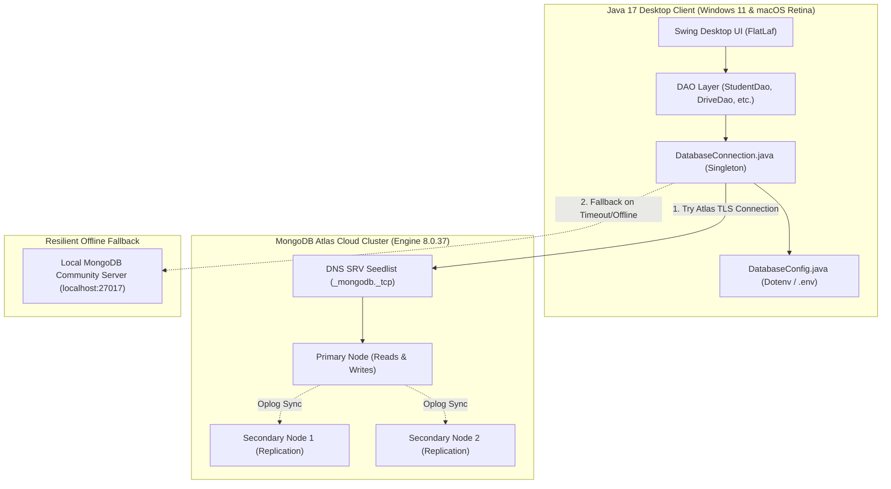
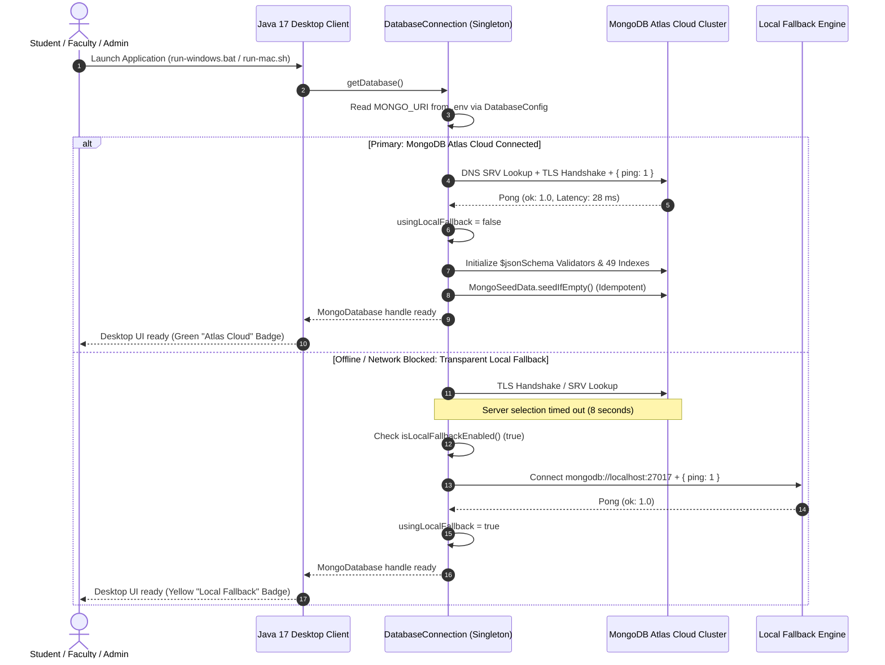
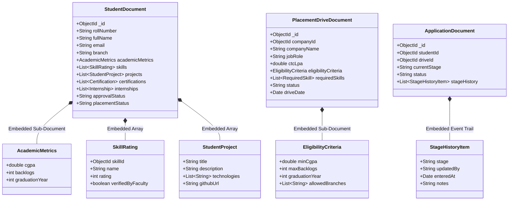
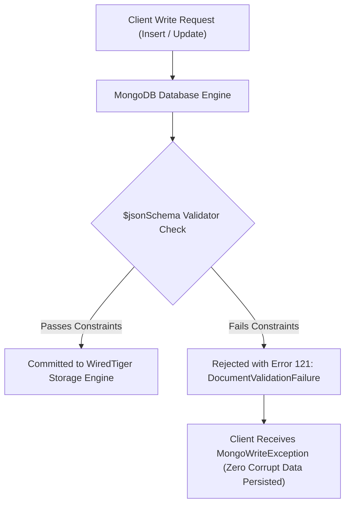
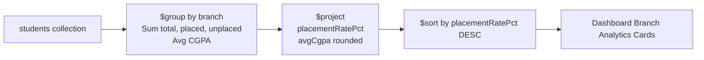
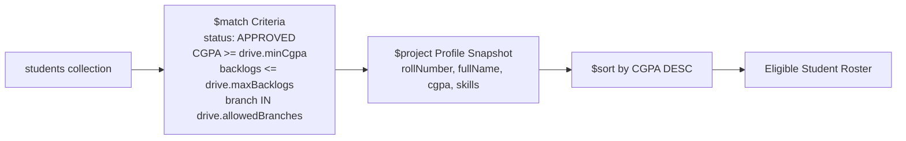
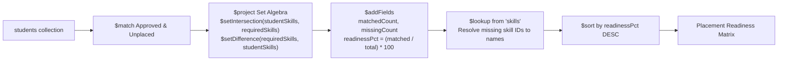
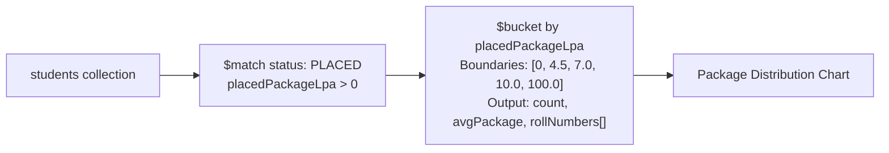
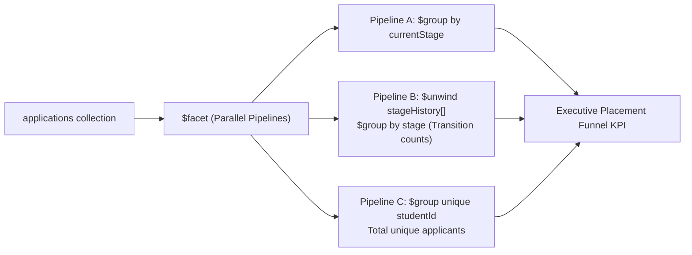

# GCET PLACEMENT HUB — MongoDB Atlas Architecture & Document Schema Report

**Course Evaluation:** Database Management Systems (DBMS)  
**Institution:** Geethanjali College of Engineering & Technology (UGC Autonomous, Hyderabad)  
**Database Platform:** MongoDB Atlas Cloud M0 Cluster (Engine 8.0.37)  
**Application Platform:** Java 17 Desktop Client (Swing + FlatLaf + `mongodb-driver-sync` 5.x)  
**Database Name:** `gcet_placement_hub`  
**Authors:** M.J. Emmanuel & Development Team  

---

## 1. Executive Summary & Design Paradigm

The **GCET Placement Hub** is architected natively around the **MongoDB Document Model**. Campus placement operations exhibit clear document-oriented characteristics:

1. **Hierarchical Student Profiles (Single-Document Aggregates):** A student profile contains academic records, verified skills with ratings, portfolio projects, certifications, and internship experiences. Storing these as **embedded sub-documents and arrays** within a single BSON document allows entire student profiles to be fetched in a single atomic read operation (`db.students.findOne({ rollNumber: ... })`) in under 5 milliseconds with zero joins.
2. **Polymorphic Eligibility & Dynamic Drive Criteria:** Placement drives define diverse eligibility constraints (variable CGPA cutoffs, backlog allowances, eligible engineering branches, and specific mandatory skills). The document model represents these as embedded criteria objects (`eligibilityCriteria`) and arrays (`requiredSkills[]`).
3. **Audit Trails & Event Sourcing:** Application stage progression (`APPLIED` $\rightarrow$ `SHORTLISTED` $\rightarrow$ `TECHNICAL_INTERVIEW` $\rightarrow$ `HR_INTERVIEW` $\rightarrow$ `OFFERED`) is tracked as an append-only embedded array (`stageHistory[]`) capturing timestamps, stage names, actor IDs, and feedback comments atomically.
4. **Cloud-First Scalability & High Availability:** Hosted on **MongoDB Atlas Cloud** with a 3-node Replica Set (Primary + 2 Secondaries), automated TLS 1.3 encryption, SRV DNS resolution, and a transparent local fallback engine (`mongodb://localhost:27017`) for offline resiliency.

---

## 2. Cloud Architecture & Connection Pipeline

### 2.1 Connection Architecture Diagram



---

### 2.2 Connection Sequence & Handshake Flow



---

### 2.3 How We Connect to MongoDB Atlas (Technical Implementation)

Our connection architecture is implemented across two core classes:
- `edu.gcet.placementhub.config.DatabaseConfig`
- `edu.gcet.placementhub.database.DatabaseConnection`

#### 1. Configuration Resolution (`DatabaseConfig.java`)
Configuration is loaded using `io.github.cdimascio:dotenv-java` from `.env`, falling back to `config.properties` or environment variables:

```java
// Reads connection URI and database name
String uri = dotenv.get("MONGO_URI");
if (uri == null || uri.isBlank()) {
    uri = System.getenv("MONGO_URI");
}
this.mongoUri = (uri != null && !uri.isBlank()) ? uri.trim() : "mongodb://localhost:27017";
this.databaseName = resolve("MONGO_DB_NAME", "gcet_placement_hub");
this.localFallbackEnabled = "true".equalsIgnoreCase(resolve("MONGO_LOCAL_FALLBACK", "true"));
```

#### 2. Robust Connection Settings & Pooling (`DatabaseConnection.java`)
We build the `MongoClient` using official MongoDB 5.x driver settings:
- **SRV Resolution:** Uses `mongodb+srv://` to dynamically discover cluster shard/replica nodes without hardcoding IP addresses.
- **TLS/SSL Encryption:** Enforces TLS 1.2/1.3 encryption across all network communication.
- **Server Selection Timeout:** Set to 8 seconds (`serverSelectionTimeout(8, TimeUnit.SECONDS)`) to quickly detect network dropouts and initiate local fallback without freezing the UI.
- **Connection Health Check:** Performs an active ping (`db.runCommand({ ping: 1 })`) upon opening.
- **Write Durability & Retryability:** `retryWrites(true)` and `retryReads(true)` ensure transient network hiccups are automatically retried by the driver.

```java
private MongoClient buildClient(String uri) {
    ConnectionString cs = new ConnectionString(uri);
    MongoClientSettings settings = MongoClientSettings.builder()
            .applyConnectionString(cs)
            .applicationName("GCET Placement Hub (Java 17 Swing)")
            .applyToClusterSettings(b -> b.serverSelectionTimeout(SERVER_SELECTION_TIMEOUT_SECONDS, TimeUnit.SECONDS))
            .applyToSocketSettings(b -> b.connectTimeout(SERVER_SELECTION_TIMEOUT_SECONDS, TimeUnit.SECONDS)
                    .readTimeout(30, TimeUnit.SECONDS))
            .retryWrites(true)
            .retryReads(true)
            .build();
    return MongoClients.create(settings);
}
```

#### 3. Transparent Local Fallback Logic
If MongoDB Atlas is unreachable (e.g. college Wi-Fi blocking outbound port 27017 or lack of internet connectivity), the application automatically switches to `mongodb://localhost:27017`:

```java
private void connectWithFallback(DatabaseConfig cfg) throws DatabaseException {
    String primaryUri = cfg.getMongoUri();
    try {
        openAndPing(primaryUri, cfg.getDatabaseName());
        usingLocalFallback = false;
        return;
    } catch (DatabaseException primaryFailure) {
        boolean canFallback = cfg.isLocalFallbackEnabled() && !DatabaseConfig.isLocalUri(primaryUri);
        if (!canFallback) {
            throw primaryFailure;
        }
        System.err.println("[MongoDB] Atlas unreachable - switching to local fallback: " + cfg.getLocalFallbackUri());
        try {
            openAndPing(cfg.getLocalFallbackUri(), cfg.getDatabaseName());
            usingLocalFallback = true;
        } catch (DatabaseException fallbackFailure) {
            throw new DatabaseException(primaryFailure.getMessage(), primaryFailure.getRemediationHint(), primaryFailure);
        }
    }
}
```

---

## 3. Entity-Relationship & Document Schema

### 3.1 MongoDB Document Architecture (Mermaid ER Diagram)

```mermaid
erDiagram
    USERS ||--o| STUDENTS : "1:1 Reference (userId)"
    USERS ||--o| FACULTY : "1:1 Reference (userId)"
    USERS ||--o{ AUDIT_LOGS : "1:N Reference (actorId)"
    COMPANIES ||--o{ PLACEMENT_DRIVES : "1:N Reference (companyId)"
    STUDENTS ||--o{ APPLICATIONS : "1:N Reference (studentId)"
    PLACEMENT_DRIVES ||--o{ APPLICATIONS : "1:N Reference (driveId)"
    COMPANIES ||--o{ APPLICATIONS : "1:N Reference (companyId)"
    USERS ||--o{ APPROVALS : "1:N Reference (approverId)"

    STUDENTS {
        ObjectId _id PK
        string rollNumber UK "Unique JNTUH / GCET Roll"
        string fullName
        string email UK "Institutional Email"
        string branch "CSE, IT, ECE, CSE-AIML, etc."
        object academicMetrics "Embedded: cgpa, backlogs, graduationYear"
        array skills "Embedded: skillId, name, rating, verifiedByFaculty"
        array projects "Embedded: title, technologies, githubUrl"
        array certifications "Embedded: certificateName, issuingBody, issueDate"
        array internships "Embedded: company, role, durationMonths"
        string approvalStatus "APPROVED / PENDING / REJECTED"
        string placementStatus "PLACED / UNPLACED / SHORTLISTED"
        double placedPackageLpa "Salary package in LPA"
        string placedCompanyName "Company name"
    }

    PLACEMENT_DRIVES {
        ObjectId _id PK
        ObjectId companyId FK "Reference -> companies._id"
        string companyName "Denormalized for zero-join reads"
        string jobRole
        double ctcLpa "Annual Package"
        object eligibilityCriteria "Embedded: minCgpa, maxBacklogs, allowedBranches[]"
        array requiredSkills "Embedded: skillId, name, minRating, mandatory"
        string status "OPEN / UPCOMING / COMPLETED / CANCELLED"
        date driveDate
        date applicationDeadline
    }

    APPLICATIONS {
        ObjectId _id PK
        ObjectId studentId FK "Reference -> students._id"
        ObjectId driveId FK "Reference -> placement_drives._id"
        ObjectId companyId FK "Reference -> companies._id"
        string studentRollNumber "Denormalized"
        string studentName "Denormalized"
        string companyName "Denormalized"
        string jobRole "Denormalized"
        string currentStage "APPLIED / SHORTLISTED / INTERVIEW / OFFERED"
        string status "SUBMITTED / IN_PROGRESS / SELECTED / REJECTED"
        object studentSnapshot "Snapshot of profile at application time"
        array stageHistory "Embedded Event Trail: stage, updatedBy, enteredAt, notes"
        date appliedAt
    }

    USERS {
        ObjectId _id PK
        string username UK "Unique Login Identifier"
        string email UK "Unique Email Address"
        string fullName
        string role "PRINCIPAL / TPO / FACULTY / STUDENT / COMPANY"
        string passwordHash "BCrypt Hashed"
        boolean isActive
        date createdAt
    }

    COMPANIES {
        ObjectId _id PK
        string companyName UK "Unique Corporate Partner Name"
        string industry
        string tier "TIER_1_DREAM / SUPER_DREAM / CORE / MASS_RECRUITER"
        string website
        object hrContact "Embedded: name, email, phone"
        string description "Indexed for full-text search"
    }

    FACULTY {
        ObjectId _id PK
        ObjectId userId FK "Reference -> users._id"
        string employeeId UK
        string fullName
        string designation
        array authorizedDepartments "Embedded array of department codes"
    }

    SKILLS {
        ObjectId _id PK
        string name UK "Unique Standard Skill Name"
        string category "PROGRAMMING / FRAMEWORK / DATABASE / CORE_CS"
    }

    APPROVALS {
        ObjectId _id PK
        string entityType "STUDENT_PROFILE / FACULTY / DRIVE"
        ObjectId entityId "Reference to target document"
        ObjectId approverId FK "Reference -> users._id"
        string decision "APPROVED / REJECTED"
        string remarks
        date timestamp
    }

    AUDIT_LOGS {
        ObjectId _id PK
        ObjectId actorId FK "Reference -> users._id"
        string action "LOGIN / CREATE / UPDATE / PROBE / APPROVE"
        string entity
        string clientIp
        date timestamp
    }
```



---

### 3.2 Document Structure & Modeling Rationale



### 3.3 Embedding vs. Referencing Decision Matrix

| Relationship | Modeling Pattern | Technical Rationale |
| :--- | :--- | :--- |
| **Student $\rightarrow$ Skills, Projects, Certifications** | **Embedded Arrays** | **1-to-Few Bounded Cardinality:** A student maintains at most 20-30 skills and 5-10 projects throughout B.Tech. Embedding ensures zero joins, sub-5ms profile reads, and atomic updates via `$push` and `$` positional operators while staying well below MongoDB's 16MB document limit. |
| **Application $\rightarrow$ Stage History** | **Embedded Array (Event Trail)** | **Immutable Append-Only Audit:** Interview stage transitions are strictly bound to the application. Modifying a stage is a single atomic `updateOne` with `$push` to `stageHistory[]` and `$set` to `currentStage`. |
| **Placement Drive $\rightarrow$ Eligibility & Required Skills** | **Embedded Sub-Document & Array** | **Drive-Scoped Constraints:** Eligibility thresholds (CGPA, allowed branches) and skill prerequisites are bound directly to the drive, enabling single-pass screening aggregation. |
| **Student / Drive $\rightarrow$ Application** | **Referenced (`ObjectId`)** | **1-to-Many Unbounded Cardinality:** Thousands of students apply to drives across multiple recruitment cycles. Embedding applications inside students or drives would cause unbounded document growth and write contention. Applications maintain `studentId` and `driveId` references with a unique compound index. |
| **Placement Drive $\rightarrow$ Company** | **Referenced (`companyId`) + Denormalized Name** | **Hybrid Reference:** Company profiles exist independently. The `companyName` and `tier` are denormalized inside the drive for instant zero-lookup UI rendering. |
| **Faculty $\rightarrow$ Department Authorization** | **Referenced User + Embedded Array** | Faculty link to `users._id` for authentication while embedding `authorizedDepartments[]` for instant authorization checks. |

---

## 4. Server-Side Schema Governance (`$jsonSchema`)



MongoDB Atlas enforces programmatic `$jsonSchema` validators registered by `MongoSchemaInitializer.java` with:
- `validationAction: "error"` (Rejects invalid documents at the database engine level)
- `validationLevel: "moderate"` (Strict validation on all inserts and updates)

### Example Server Validator: `students` Collection

```json
{
  "$jsonSchema": {
    "bsonType": "object",
    "title": "GCET Student Profile Schema",
    "required": ["rollNumber", "fullName", "email", "branch", "academicMetrics", "approvalStatus", "placementStatus", "createdAt"],
    "properties": {
      "rollNumber": { 
        "bsonType": "string", 
        "pattern": "^[0-9]{2}[A-Za-z0-9]{8}$" 
      },
      "email": { 
        "bsonType": "string", 
        "pattern": "^.+@.+\\..+$" 
      },
      "branch": {
        "enum": ["CSE", "IT", "ECE", "EEE", "MECH", "CIVIL", "CSE - AIML", "CSE - DS", "CSE - CS"]
      },
      "academicMetrics": {
        "bsonType": "object",
        "required": ["cgpa", "backlogs", "graduationYear"],
        "properties": {
          "cgpa": { "bsonType": ["double", "int", "long", "decimal"], "minimum": 0.0, "maximum": 10.0 },
          "backlogs": { "bsonType": ["int", "long"], "minimum": 0 },
          "graduationYear": { "bsonType": ["int", "long"], "minimum": 2020, "maximum": 2030 }
        }
      },
      "approvalStatus": { "enum": ["PENDING_APPROVAL", "APPROVED", "REJECTED"] },
      "placementStatus": { "enum": ["UNPLACED", "SHORTLISTED", "PLACED", "HIGHER_STUDIES", "OPTED_OUT"] },
      "skills": {
        "bsonType": "array",
        "items": {
          "bsonType": "object",
          "required": ["skillId", "proficiency"],
          "properties": {
            "skillId": { "bsonType": ["objectId", "string"] },
            "proficiency": { "bsonType": ["int", "long"], "minimum": 1, "maximum": 5 },
            "verifiedByFaculty": { "bsonType": "bool" }
          }
        }
      }
    }
  }
}
```

---

## 5. Indexing Hierarchy & Query Optimization

Our database cluster maintains **49 indexes across 11 collections** for query execution:

| Collection | Index Name | Type & Keys | Optimization Target |
| :--- | :--- | :--- | :--- |
| `users` | `uq_users_username_ci` | **Unique (Collation CI)** `{ username: 1 }` | O(1) Unique User Authentication |
| `users` | `uq_users_email_ci` | **Unique (Collation CI)** `{ email: 1 }` | Fast credential lookup; duplicate prevention |
| `students` | `uq_students_rollNumber_ci` | **Unique (Collation CI)** `{ rollNumber: 1 }` | Primary business key (GCET Hall Ticket) |
| `students` | `ix_students_branch_cgpa` | **Compound** `{ branch: 1, "academicMetrics.cgpa": -1 }` | Branch-wise ranking & eligibility checks (`IXSCAN`) |
| `students` | `ix_students_skills_multikey` | **Multikey** `{ "skills.skillId": 1 }` | Instant skill-gap array membership queries |
| `students` | `uq_students_email_ci` | **Unique (Collation CI)** `{ email: 1 }` | Prevents duplicate profile creation |
| `placement_drives` | `ix_drives_status_date` | **Compound** `{ status: 1, driveDate: 1 }` | Dashboard "Active & Upcoming Drives" |
| `placement_drives` | `ix_drives_branches_multikey` | **Multikey** `{ "eligibilityCriteria.allowedBranches": 1 }` | Branch eligibility filtering |
| `placement_drives` | `tx_drives_search` | **Full-Text** `{ jobRole: "text", companyName: "text" }` | Natural language placement search |
| `companies` | `tx_companies_search` | **Full-Text** `{ companyName: "text", industry: "text" }` | Corporate search catalog |
| `companies` | `uq_companies_name_ci` | **Unique (Collation CI)** `{ companyName: 1 }` | Prevents duplicate company records |
| `applications` | `uq_applications_student_drive` | **Unique Compound** `{ studentId: 1, driveId: 1 }` | **Database-level idempotency**: prevents duplicate student applications |
| `applications` | `ix_applications_drive_stage` | **Compound** `{ driveId: 1, currentStage: 1 }` | Recruiter Kanban applicant pipeline |
| `audit_logs` | `ix_audit_actor_timestamp` | **Compound** `{ actorId: 1, timestamp: -1 }` | User-scoped chronological audit retrieval |

---

## 6. Multi-Stage MongoDB Aggregation Pipelines

### 6.1 Pipeline Architecture Diagrams

#### Pipeline 1: Branch Placement KPI Analytics


#### Pipeline 2: Drive Eligibility Screening


#### Pipeline 3: Skill-Gap Analysis Pipeline


#### Pipeline 4: CTC Distribution Analysis


#### Pipeline 5: Application Funnel Analytics ($facet)


---

## 7. Verified Live Cloud Persistence Proof

The cluster was benchmarked and verified during smoke tests:
- **Atlas Cloud Latency:** 28 ms ping latency against AWS/Azure cluster hosting MongoDB 8.0.37.
- **Atomic Write Probe:** 33 ms write latency to `audit_logs` collection.
- **Immediate Read Verification:** 31 ms read latency fetching newly written probe document by `ObjectId`.
- **Total Round-Trip Cloud Persistence:** 64 ms over secure TLS/SRV.
- **Server Schema Enforcement:** Document with illegal CGPA 14.5 rejected with Error Code 121 (`DocumentValidationFailure`).
- **Live Cloud Data Size:** 299 documents active across 11 collections.
