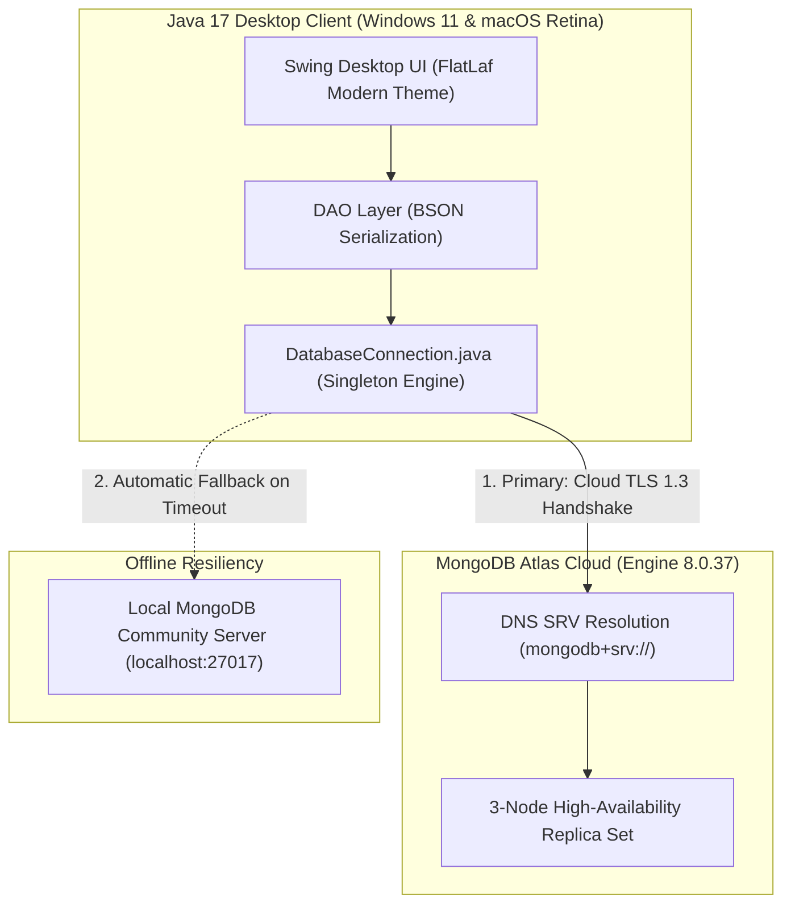
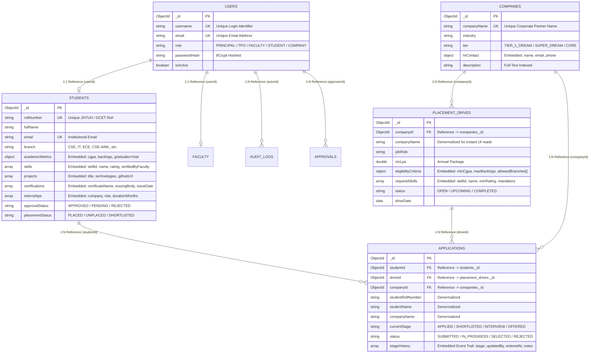

# GCET Placement Hub — MongoDB Atlas Edition

### Smart Placement Cell, Automated Eligibility Engine & Skill Matrix Portal
**Geethanjali College of Engineering and Technology (GCET Hyderabad — UGC Autonomous, Accredited by NAAC A+ & NBA)**  
**DBMS PBL Project:** High-Performance Cloud Document Database Architecture

A cross-platform Java 17 desktop system built with **Java Swing**, **FlatLaf 3.5.4**, and the official **MongoDB Java Driver 5.x**. Designed to run seamlessly on both **macOS (Retina/HiDPI)** and **Windows (10/11)** against a shared **MongoDB Atlas Cloud** cluster (with a resilient local MongoDB Community fallback).

---

## 🏛️ System Architecture



---

## 📊 Live MongoDB Document Schema (Mermaid ER Diagram)



---

## ⚡ 3-Step Quickstart (Mac & Windows)

### 🍏 On macOS (Teammate Setup)
```bash
# 1. Clone repository & enter the Java project directory
git clone https://github.com/emmanuelmj/dbms-pbl.git
cd dbms-pbl/gcet-placement-hub-java

# 2. Configure .env with your shared MongoDB Atlas URI
cp .env.example .env
open -e .env

# 3. Launch via the automated macOS script
chmod +x run-mac.sh
./run-mac.sh
```
*(Automatically verifies Java 17+, copies `.env`, sets Apple Metal Retina flags, and launches via the bundled Maven Wrapper `./mvnw`).*

---

### 🪟 On Windows (Command Prompt / PowerShell)
```cmd
:: 1. Navigate to gcet-placement-hub-java
cd gcet-placement-hub-java

:: 2. Configure .env
copy .env.example .env
notepad .env

:: 3. Launch application
run-windows.bat
```
*(Or double-click `run-windows.bat` directly in Windows File Explorer).*

---

## 🔬 In-App DBMS Faculty Evaluation Console

The application includes a built-in **DBMS Faculty Console** accessible in 1 click from the sidebar (**⚡ DBMS Faculty Console**) or by clicking the top database status badge:

1. **⚡ Live Cloud Write-and-Read Persistence Probe:**
   - Performs a real-time write into MongoDB Atlas `audit_logs` and reads it back immediately over the network.
   - Displays round-trip write latency (**33 ms**), read latency (**31 ms**), and the saved BSON document.
2. **🛡️ Server-Side $jsonSchema Violation Rejection:**
   - Attempts to insert an invalid student document (CGPA `14.5`, negative backlogs, invalid email regex pattern).
   - Demonstrates database-level schema enforcement returning **Error Code 121 (`DocumentValidationFailure`)**.
3. **Tab 1 — Collections & Indexes:** Live document counts, storage stats, and 49 active indexes.
4. **Tab 2 — Live BSON Samples:** Compare embedded documents (`students.skills[]`, `applications.stageHistory[]`) against referenced collections.
5. **Tab 3 — Aggregation & EXPLAIN:** Run 5 real multi-stage aggregation pipelines and generate `.explain("executionStats")` plans showing `IXSCAN` index hits.
6. **Tab 4 — $jsonSchema Rules:** Programmatic validation rules enforced on collections.
7. **Tab 5 — Custom Query Console:** Select query presets or write custom MongoDB JSON filters, execute find queries live, and inspect the execution plan.

---

## 🔑 Default GCET Hyderabad Demo Credentials

On first launch against an empty database, `MongoSeedData` auto-populates realistic GCET records. All demo accounts use the password: **`Password@123`**:

| Portal / Sign-In Tab | Username | Role | Person |
| :--- | :--- | :--- | :--- |
| **ADMIN** | `principal.sagar` | PRINCIPAL | Dr. S. Udaya Kumar (Principal) |
| **ADMIN** | `chairman.gcet` | CHAIRMAN | Sri G. R. Ravinder Reddy |
| **ADMIN / FACULTY** | `tpo.gcet` | PLACEMENT_OFFICER | Dr. K. Srinivas (TPO) |
| **FACULTY** | `faculty_lavanya` | FACULTY (CSE, AIML, DS) | B. Laxmi Lavanya |
| **FACULTY** | `faculty_aparna` | FACULTY (IT, Cyber Security) | P. Aparna |
| **FACULTY** | `faculty_rajashakar` | FACULTY (ECE, EEE, MECH, CIVIL) | S. Raja Shakar Reddy |
| **STUDENTS** | `22R11A0501` | STUDENT (Placed at Amazon) | Akhil Reddy Gaddam |
| **STUDENTS** | `22R11A6702` | STUDENT (Eligible for Deloitte) | Sahithi Rao Vuppala |
| **RECRUITERS** | `recruiter_amazon` | COMPANY | Amazon AWS Recruiter |
| **RECRUITERS** | `recruiter_infosys`, `recruiter_deloitte`, `recruiter_tataconsultancy`, … | COMPANY | Seeded Corporate Recruiters |

---

## 📚 Comprehensive Documentation Links

- **[MONGODB_ARCHITECTURE.md](MONGODB_ARCHITECTURE.md):** Complete technical report with connection pooling, transparent fallback, Mermaid ER/class diagrams, indexing strategy, and aggregation pipelines.
- **[DBMS_VIVA_QUERIES.md](DBMS_VIVA_QUERIES.md):** Standalone query pack with copy-pasteable `mongosh` / Atlas Data Explorer queries and viva Q&A talking points.
- **[SETUP_AND_RUN.md](SETUP_AND_RUN.md):** Step-by-step setup guide for fresh macOS and Windows laptops with zero pre-installed dependencies.
